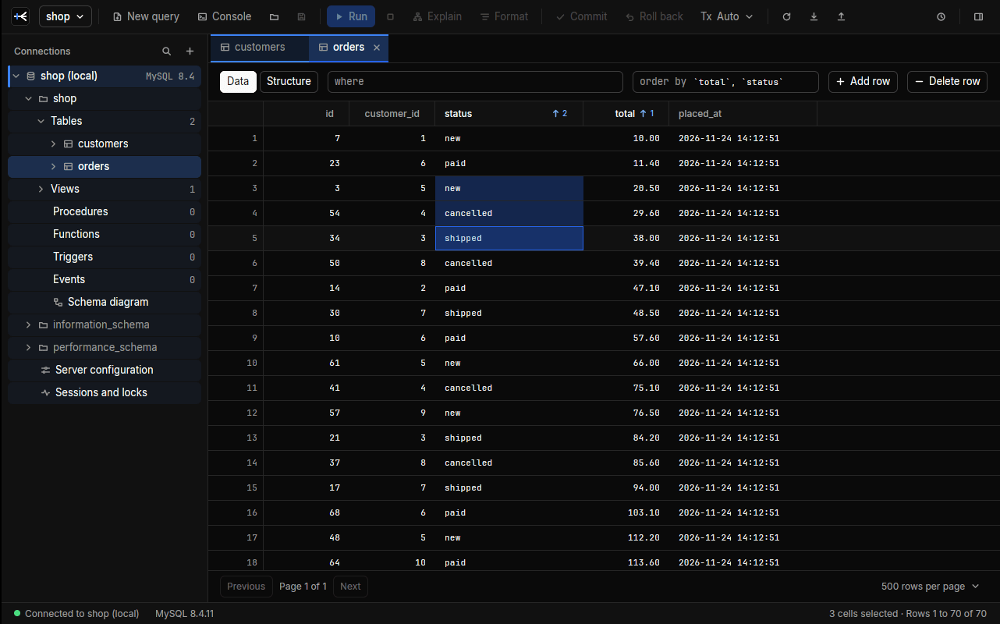
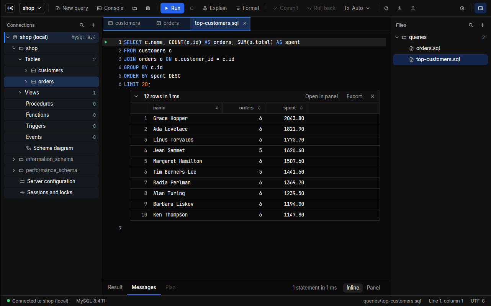
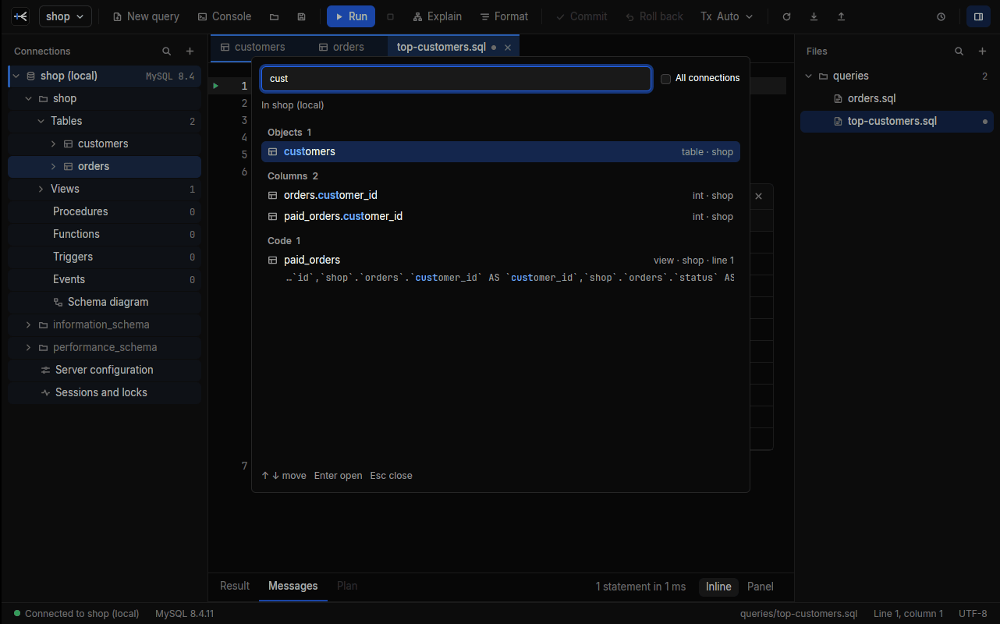
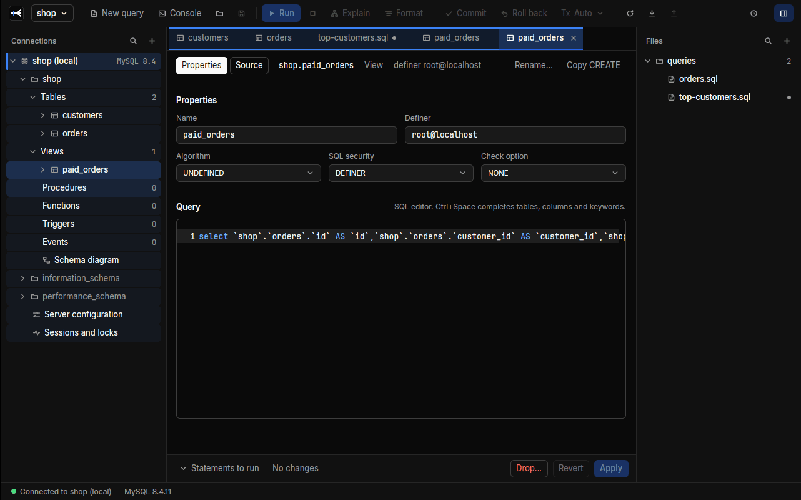
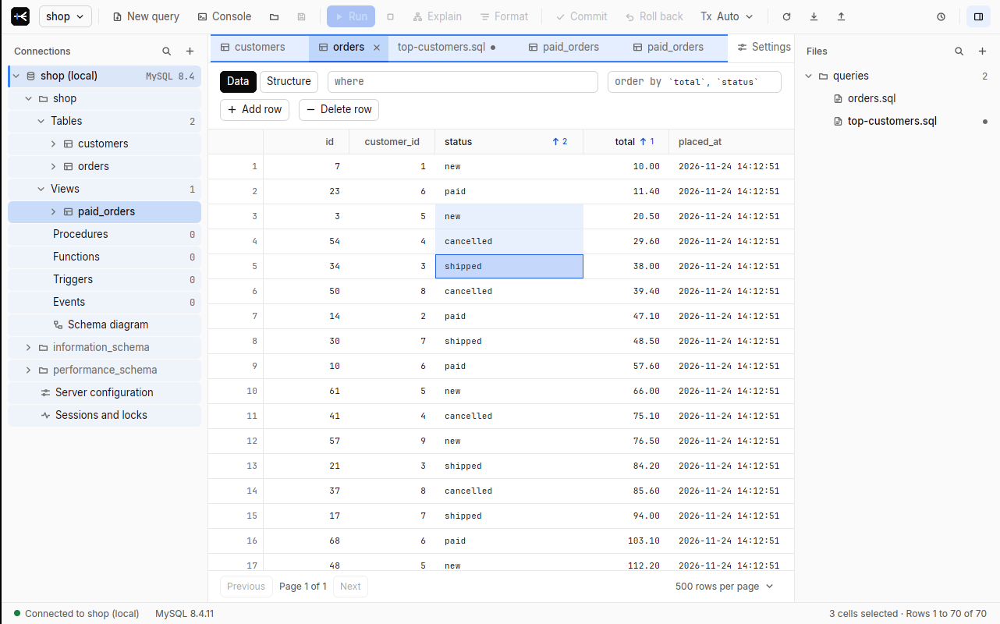

<p align="center">
  
</p>

<h1 align="center">Deadlock</h1>

<p align="center">
  A native database IDE for MySQL, MariaDB, Oracle and Redis, written in Rust.
</p>

<p align="center">
  <a href="https://github.com/lamka02sk/deadlock/actions/workflows/ci.yml"></a>
  <a href="LICENSE"></a>
  <a href="https://github.com/lamka02sk/deadlock/releases"></a>
</p>

Deadlock is a desktop app built on [GPUI](https://www.gpui.rs) and
[gpui-component](https://github.com/longbridge/gpui-component). Its data grid handles
millions of rows, and your connections live in a plain project folder you can commit
next to your code.



## Screenshots

| | |
|---|---|
|  |  |
| SQL editor with inline results and the Files panel | Global search (double Shift) |
|  |  |
| Form-based object editor (a view, MySQL) | Data grid in the light theme, with multi-column sort and a cell selection |

## Features

**Engines**

- MySQL and MariaDB (one driver, the flavor is detected from the server).
- Oracle through a built-in Thin driver, or the Thick driver (ODPI-C) when the server
  needs Oracle Instant Client.
- Redis: key browser with namespaces, server-side search, editors for strings, hashes,
  lists, sets, sorted sets, streams and JSON, clients, slow log and server configuration.
  Cluster and Sentinel are not supported yet.

**Data grid**

- Explicit paging with a page size, an optional "count all rows", row numbers that
  continue across pages.
- Multi-column sort (Shift+click), multi-cell selection, copy as text, INSERT, CSV or
  JSON, paste, duplicate, delete, set NULL or DEFAULT, JSON editor and date-time picker.
- Edits are pending changes you apply explicitly. Transaction mode is Auto or Manual,
  with Commit and Roll back in the toolbar.

**SQL**

- Editor with syntax highlighting, autocomplete (objects, columns, keywords), SQL
  formatting, run statement / run file / stop, inline or panel results.
- Console, query history, explain plans (plain and measured), import (CSV) and export
  (CSV, TSV, JSON, SQL).

**Schema and administration**

- Object tree with tables, views, routines, triggers, events and, per engine, sequences,
  synonyms, materialized views, packages and types.
- Form-based object editors that apply changes safely: check, swap, restore.
- Schema diagram, table structure editor, sessions and locks, server configuration.

**Navigation**

- Global search (double Shift) across objects, columns and source text.
- Files panel for the project's `.sql` files: tree, rename, new, delete to trash,
  live file watcher.
- Hide schemas you never use; the server keeps them.

**Connections and safety**

- A project is a folder. Connections live in `.deadlock/project.toml`.
- Passwords go to the OS keychain and are never written to project files.
- Per-connection color, environment (Development, Staging, Production) with PROD/STAGE
  tab badges, read-only connections, confirmation for dangerous statements.
- TLS modes (Off, Prefer, Require, Verify certificate) and SSH tunnels with key file,
  SSH agent or password, plus host key checking.
- Connections reconnect after a lost session.
- Light, dark or system theme, and every shortcut can be rebound in Settings.

## Install

### Download

Packages are attached to each [release](https://github.com/lamka02sk/deadlock/releases)
by CI:

| Platform | Package |
|---|---|
| Linux x86_64 | `deadlock_<version>_amd64.deb`, `Deadlock-<version>-x86_64.AppImage` |
| macOS (Apple Silicon) | `Deadlock-<version>-arm64.dmg` |

The macOS app is ad-hoc signed, not notarized. On first launch macOS blocks it until you
allow it in System Settings, Privacy & Security, Open Anyway. There is no Windows package
yet.

At run time on Linux you need glibc, libxcb, libxkbcommon(-x11), fontconfig / freetype
and a Vulkan driver (`libvulkan1` plus Mesa or a vendor driver); on Wayland also
libwayland-client. The `.deb` declares these. The AppImage uses the host's libraries.
Packages are built on the CI image's glibc, so they run on systems with that glibc or
newer.

### Build from source

You need a stable Rust toolchain (the crates use edition 2024, so Rust 1.85 or newer; CI builds with the latest stable).

- **Linux (Debian / Ubuntu):**
  `sudo apt-get install clang libfontconfig-dev libwayland-dev libxkbcommon-x11-dev libx11-xcb-dev libssl-dev libzstd-dev libasound2-dev libvulkan1`
- **macOS:** Xcode command line tools.
- **Windows:** not built or tested yet.

```sh
git clone https://github.com/lamka02sk/deadlock
cd deadlock
cargo run --release -p deadlock              # open-project window
cargo run --release -p deadlock -- <folder>  # open a project folder (or a .sql file)
```

Oracle Thin needs nothing extra. For Thick connections, install
[Oracle Instant Client](https://www.oracle.com/database/technologies/instant-client.html)
and set `DEADLOCK_ORACLE_CLIENT_DIR` if it is not on the loader path.

## Quick start

1. Start Deadlock and open a folder (`Ctrl+Shift+O`). Any folder works; Deadlock adds a
   `.deadlock/` directory to it.
2. Add a connection with the `+` in the Connections sidebar. Choose the engine, host and
   credentials, optionally a color, environment and SSH tunnel.
3. Double-click the connection to connect, expand the tree and double-click a table to
   see its data, or press `Ctrl+N` for a new query.

Commit `.deadlock/project.toml` to share connections with your team; it holds no
passwords. Per-machine state (open tabs, window size) lives in `.deadlock/state.json`.

### Shortcuts

`Ctrl` is `Cmd` on macOS. Every shortcut can be changed in Settings (`Ctrl+,`).

| Action | Shortcut |
|---|---|
| New query / open file / save | `Ctrl+N` / `Ctrl+O` / `Ctrl+S` |
| Close tab / reopen closed tab | `Ctrl+W` / `Ctrl+Shift+T` |
| Run statement / run file / stop | `Ctrl+Enter` / `Ctrl+Shift+Enter` / `Ctrl+F2` |
| Console | `Ctrl+Shift+N` |
| Format SQL | `Ctrl+Alt+L` |
| Explain plan / measured | `Ctrl+Shift+E` / `Ctrl+Alt+Shift+E` |
| Commit transaction | `Ctrl+Alt+Shift+Enter` |
| Search everywhere | double `Shift` or `Ctrl+Shift+P` |
| Search connections and objects | `Ctrl+Shift+F` |
| Files panel / filter files | `Ctrl+Alt+B` / `Ctrl+Alt+F` |
| Query history | `Ctrl+H` |
| Autocomplete | `Ctrl+Space` |
| Refresh schema | `F5` |
| Open project folder | `Ctrl+Shift+O` |
| Settings | `Ctrl+,` |

In the data grid: `Enter` edits a cell, `Alt+Insert` adds a row, `Delete` deletes the
selected rows, `Ctrl+Z` undoes a pending change, `Shift`+arrows extend the selection,
`Ctrl+Alt+N` sets NULL, `Ctrl+Alt+D` sets DEFAULT and `Ctrl+T` switches to the transposed
view (one row as a column / value list).

## Project layout

| Path | What it is |
|---|---|
| `crates/deadlock-core` | UI-free library: drivers (MySQL/MariaDB, Oracle, Redis), SSH tunnels, project files and keychain, schema cache, completion, import/export, explain plans, history. Owns the tokio runtime. |
| `crates/deadlock` | The GPUI application: windows, sidebar, editors, data grid, object editors, settings, keymap. |
| `vendor/` | Vendored `gpui-base` and `gpui-component` with Deadlock's patches, see [`vendor/gpui-base/PATCHES.md`](vendor/gpui-base/PATCHES.md). They are excluded from the workspace and built as dependencies. |
| `packaging/` | `.deb` / AppImage (`linux/`) and `.dmg` (`macos/`) scripts used by CI. |
| `docker-compose.yml` | Databases and an SSH server for the integration tests. |

The UI never blocks on I/O: it talks to `deadlock-core` over channels.

## Development

```sh
cargo run -p deadlock                                   # debug build
cargo fmt --all --check
cargo clippy --workspace --all-targets -- -D warnings
cargo test --workspace
```

The engine tests are `#[ignore]`d because they need real servers. Start the databases
and the SSH server from `docker-compose.yml` (MySQL 8.4 on 3306, MariaDB 11 on 3307,
Oracle Free 23 on 1521, Redis 8 on 6379, OpenSSH on 2222; all bound to 127.0.0.1):

```sh
docker compose up -d --wait
cargo test -p deadlock-core --test engines -- --ignored --skip big_schema
cargo test -p deadlock-core --test redis -- --ignored --test-threads 1
DEADLOCK_TEST_ORACLE=thick cargo test -p deadlock-core --test engines -- --ignored --skip big_schema  # Thick driver, needs Instant Client
docker compose down
```

Building the packages locally: `packaging/linux/package.sh` (needs `dpkg-dev`,
`desktop-file-utils` and `curl`) or `packaging/macos/package.sh` (macOS only). Output goes
to `target/package/`.

See [CONTRIBUTING.md](CONTRIBUTING.md) for the workflow.

## Status and roadmap

Deadlock is at version 0.1 and under active development. The planned phases are built
for all four engines; the per-phase notes, including known gaps, are in
[PLAN.md](PLAN.md). Not done yet:

- Windows packages.
- Redis Cluster and Sentinel.
- Some SSH details: `~/.ssh/config` is not read, and `@revoked` / `@cert-authority`
  lines in `known_hosts` are ignored.

Changes are listed in [CHANGELOG.md](CHANGELOG.md).

## Contributing, security, license

- [CONTRIBUTING.md](CONTRIBUTING.md) explains how to build, test and send changes.
- Please follow the [Code of Conduct](CODE_OF_CONDUCT.md).
- Report vulnerabilities privately, see [SECURITY.md](SECURITY.md).
- License: [MIT](LICENSE). Bundled upstream code in `vendor/` keeps its own Apache-2.0
  license.
